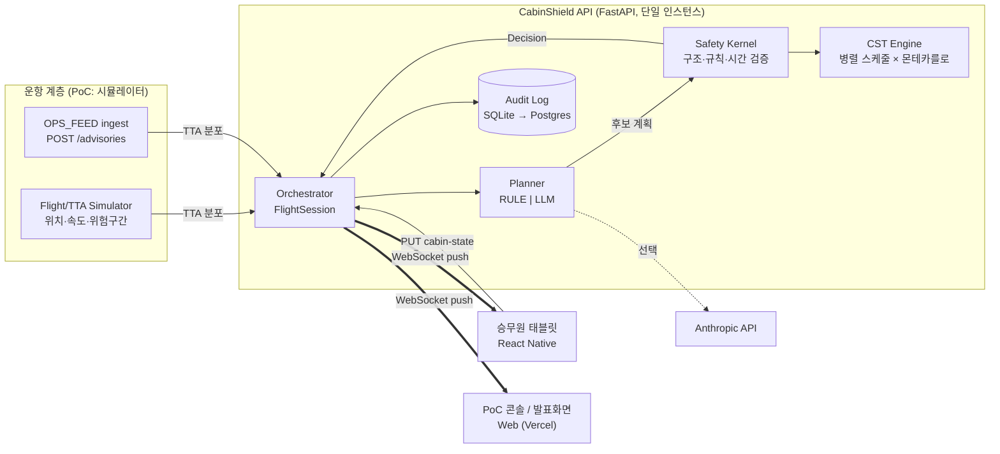
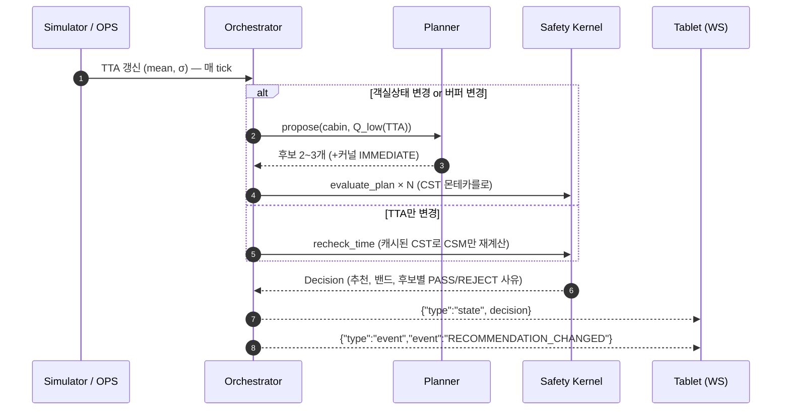
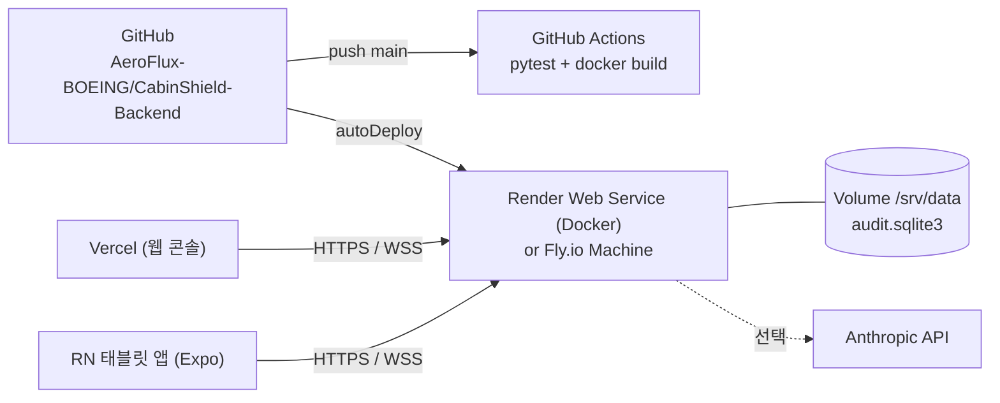

# CabinShield-SM 백엔드 아키텍처 (PoC v0.1)

> 목표: 하나의 대표 시나리오에서 **TTA 자동수신 → CST 계산 → CSM 계산 → AI 후보계획 → Safety Kernel 검증 → 승무원 화면 표시**가 실제 코드로 끊김 없이 돌아가는 것.
> 인증 제품이 아니라 판단 흐름을 검증하는 소프트웨어 시제품이다. 모든 수치·임계값은 설명용 기본값이며 항공업계 표준이 아니다.

---

## 1. 전체 구성



**핵심 원칙**

| 원칙 | 구현 위치 |
|---|---|
| 승무원은 난기류를 입력하지 않는다. TTA는 운항 계층에서 자동 수신 | `engine/tta.py`, `POST /advisories` |
| TTA는 단일값이 아니라 범위. 보수적 하한 Q_low 사용 | `tta_estimate()` (기본 10% 분위) |
| CST ≠ 행동시간 합. 병렬·이동·선행조건 반영 | `engine/cst.py` |
| AI는 후보만 만든다. 판정은 결정론적 커널 | `planner/` → `kernel.py` |
| 입력이 불확실하면 보수적으로 | `fail_safe_reasons()` → 버퍼 가산 / 즉시 자기보호 |
| 모든 판정은 재현 가능해야 한다 | `store.py` 감사로그 |

---

## 2. 판정 파이프라인



### 2.1 CSM

```
CSM = Q_low(TTA) − Q_high(CST) − B
  Q_low(TTA)  : TTA 정규근사 10% 분위   (CS_TTA_QUANTILE_LOW)
  Q_high(CST) : CST 몬테카를로 90% 분위 (CS_CST_QUANTILE_HIGH)
  B           : 안전버퍼 10s            (CS_SAFETY_BUFFER_S), Fail-safe 시 +15s
```

### 2.2 CST 엔진 (`engine/cst.py`)

- 각 행동 소요시간 ~ LogNormal(median, σ). 통로 혼잡도에 따라 이동시간 × (1 + 0.5·congestion)
- 승무원별 타임라인을 순서대로 쌓되, 시작시각 = max(본인 가용시각 + 이동, 선행조건 완료)
  - 카트 관련 행동 ← `STOP_SERVICE` 완료, 같은 카트의 이전 행동 완료
  - `SECURE_GALLEY(z)` ← 그 갤리로 복귀하는 카트 전부 완료
- 모든 승무원의 마지막 행동은 `CREW_SELF_PROTECT` → **CST = 마지막 승무원 착석시각(makespan)**
- N=2000 샘플을 numpy로 벡터화 → 후보 1개당 수 ms

### 2.3 Safety Kernel 검증 순서 (`kernel.py`)

1. **구조**: 승인 행동만(`NOT_IN_LIBRARY`), 존재하는 승무원·대상(`BAD_TARGET`), 자기보호 이후 행동 금지(`AFTER_SELF_PROTECT`), 전원 자기보호 포함(`MISSING_SELF_PROTECT`)
2. **선행조건/금지행동**: 상태를 순서대로 적용하며 검사
   - 서비스 중인데 `STOP_SERVICE` 없이 정리 → `SERVICE_NOT_STOPPED`
   - 뜨거운 음료 미수납 상태로 카트 이동 → `FORBIDDEN`
   - 갤리 잠근 뒤 카트 복귀 → `ORDER`
3. **시간**: CSM ≥ 0 → PASS
4. **랭킹**: (CSM ≥ 5s 우선) → 잔여위험 최소 → CSM 최대
5. **Fail-safe**: 통과 후보 없음 → 커널이 만든 `KERNEL-IMMEDIATE`(전원 즉시 착석) 강제 추천, `NO_FEASIBLE_PLAN`

**밴드** (설명용): 추천이 자기보호만이거나 CSM<0 → `RED`, CSM ≥ 15s → `GREEN`, 그 외 → `AMBER`

### 2.4 대표 시나리오 실행 결과 (A320 / 4명 / HOT_BEVERAGE / CART1 MID 미고정 / LAV-AFT 점유)

| 시뮬 시간 | Q_low(TTA) | 추천 | CSM | 밴드 |
|---|---|---|---|---|
| t=20s (Advisory 자동수신) | 111s | RULE-FULL (카트 갤리 복귀 + 갤리 정리) | +44s | GREEN |
| t=50s | 81s | RULE-FULL | +15s | AMBER |
| t=60s | 71s | **RULE-MINIMAL** (카트 현장 고정, 갤리 포기) | +34s | GREEN |
| t=80s | 52s | RULE-MINIMAL | +14s | AMBER |
| t=90s | 42s | **KERNEL-IMMEDIATE** (즉시 자기보호) | +20s | RED |

→ "시간이 줄어들수록 비필수 업무를 포기하고 자기보호로 전환"이 자동으로 일어나는 장면을 그대로 데모에 쓸 수 있다.

---

## 3. 데이터 모델 요약 (`models.py`)

```text
CabinState
 ├ service_type: NONE | HOT_BEVERAGE | COLD_BEVERAGE | MEAL
 ├ service_active: bool
 ├ aisle_congestion: 0..1
 ├ crew[]:       {id, zone: FWD|MID|AFT, role}
 ├ carts[]:      {id, zone, status: STOWED|AISLE_UNSECURED|AISLE_SECURED, hot_liquid}
 ├ lavatories[]: {id, zone, occupied}
 ├ galleys[]:    {zone: FWD|AFT, secured}
 └ updated_at

TtaEstimate   {source: SIMULATOR|OPS_FEED, advisory_id, severity, tta_mean_s, tta_sigma_s, tta_low_s, tta_high_s, issued_at}
Plan          {plan_id, source: RULE|LLM|KERNEL_FALLBACK, label, steps[{action_id, crew_id, target_id}], rationale}
PlanEvaluation{plan, verdict: PASS|REJECT, reasons[], cst{median, high, per_crew, timeline[]}, csm_s, residual_hazard, residual_items[]}
Decision      {flight_id, tta, buffer_s, band, fail_safe, fail_safe_reasons[], recommended, candidates[]}
```

행동 라이브러리 (`library.py`, 9개 + 내부 이동/인지지연):
`STOP_SERVICE`, `STOW_HOT_LIQUID`, `SECURE_CART_IN_PLACE`, `RETURN_CART_TO_GALLEY`, `LAV_PAX_GUIDANCE`, `SECURE_GALLEY`, `PA_SEATBELT`, `CABIN_CHECK_ZONE`, `CREW_SELF_PROTECT`
→ 소요시간 값은 placeholder. **팀 반복측정 후 median/σ를 교체**할 것 (측정값은 알고리즘 시연용이지 실제 승무원 성능이 아님).

---

## 4. API

인증: `CS_API_KEY` 설정 시 쓰기 요청은 `X-API-Key` 헤더, WebSocket은 `?token=`.

| Method | Path | 호출 주체 | 설명 |
|---|---|---|---|
| GET | `/healthz` | 인프라 | 헬스체크 |
| GET | `/api/v1/library` | 앱 | 승인 행동 목록 |
| GET | `/api/v1/scenarios` | 콘솔 | 프리셋 시나리오 |
| POST | `/api/v1/evaluate` | 콘솔/테스트 | 세션 없이 1회 판정 (cabin + tta_mean_s) |
| POST | `/api/v1/flights` | 콘솔 | 세션 생성 `{scenario, flight_id?, initial_tta_s?, autostart}` |
| GET | `/api/v1/flights/{id}` | 앱 | 스냅샷 (phase, sim, cabin, decision) |
| PUT | `/api/v1/flights/{id}/cabin-state` | **태블릿** | 객실상태 갱신 → 즉시 재판정 |
| POST | `/api/v1/flights/{id}/advisories` | **운항계층** | 외부 난기류 이벤트 ingest (시뮬레이터보다 우선) |
| POST | `/api/v1/flights/{id}/sim/start` · `/stop` | 콘솔 | 실시간 시뮬레이터 |
| POST | `/api/v1/flights/{id}/sim/step?seconds=N` | 발표 | 일시정지 상태에서 N초 전진 |
| GET | `/api/v1/flights/{id}/decision` | 앱 | 최신 판정 |
| GET | `/api/v1/flights/{id}/audit` | 심사/디버그 | 판정 이력 |
| WS | `/ws/flights/{id}` | 태블릿/콘솔 | `state` / `event` / `ping`(15s) 푸시 |

이벤트 종류: `ADVISORY_RECEIVED`, `RECOMMENDATION_CHANGED`, `TURBULENCE_ENCOUNTER`, `TURBULENCE_CLEARED`

**phase 상태기계**: `MONITORING → ADVISORY → IN_TURBULENCE → CLEARED`

---

## 5. 배포 인프라



| 항목 | 선택 | 이유 |
|---|---|---|
| 런타임 | Docker (python:3.12-slim), uvicorn **workers=1** | 세션·WS 구독자가 프로세스 메모리에 있음 |
| 호스팅 1안 | **Render** (`render.yaml` Blueprint) | GitHub 연결만으로 배포, WS 지원. 무료는 15분 idle 슬립 → 발표 전 `/healthz`로 깨우기 |
| 호스팅 2안 | **Fly.io** (`fly.toml`, nrt 리전) | 도쿄 리전 → 국내 지연 낮음, `min_machines_running=1`로 슬립 방지, 볼륨으로 감사로그 유지 |
| 저장소 | SQLite 감사로그 | PoC에 충분. Render 무료 플랜 디스크는 재배포 시 초기화됨 |
| 비밀 | `CS_API_KEY`, `CS_ANTHROPIC_API_KEY` | 대시보드 secrets로만 주입, 레포 커밋 금지 |
| CI | GitHub Actions | 커널 규칙 테스트가 깨지면 배포 전 차단 |

### 스케일 아웃이 필요해질 때 (본선 이후)

1. 세션 상태 → **Redis** (hash + pub/sub로 WS 팬아웃), 인스턴스 N개
2. 감사로그 → **Postgres** (`AuditStore` 인터페이스만 교체)
3. 시뮬레이터 루프 → 별도 워커 프로세스(“운항 계층” 역할 분리), API는 `/advisories`만 수신
4. LLM 호출 → 비동기 큐 + 타임아웃 엄수 (커널 판정은 LLM 응답을 기다리지 않고 규칙 후보로 먼저 표시)

---

## 6. 프론트엔드 연동 가이드 (RN + TypeScript)

```ts
const ws = new WebSocket(`${WS_BASE}/ws/flights/${flightId}?token=${API_KEY}`);
ws.onmessage = (e) => {
  const msg = JSON.parse(e.data);
  if (msg.type === "state") {
    const d = msg.data.decision;            // null이면 MONITORING
    // d.tta.tta_low_s, d.recommended.cst.cst_high_s, d.buffer_s, d.recommended.csm_s, d.band
    // d.recommended.cst.timeline → 승무원별 할 일 카드
    // d.candidates[].verdict / reasons → "AI Plan A: REJECT / Plan B: PASS"
  } else if (msg.type === "event" && msg.event === "RECOMMENDATION_CHANGED") {
    // 햅틱 + 배너
  }
};
// 객실상태 변경 (서비스 시작, 카트 반출 등 평소에 갱신)
await fetch(`${API}/api/v1/flights/${flightId}/cabin-state`, {
  method: "PUT", headers: { "content-type": "application/json", "X-API-Key": API_KEY },
  body: JSON.stringify(cabin),
});
```

타입은 `GET /openapi.json` → `openapi-typescript`로 자동 생성 권장.

---

## 7. 팀 작업 분담 제안

| 담당 | 작업 | 파일 |
|---|---|---|
| 측정 | 행동별 반복측정 → median/σ 산출 | `library.py` |
| 커널 | 금지행동·선행조건 규칙 추가, 임계값 근거 정리 | `kernel.py`, `tests/test_kernel.py` |
| AI | 프롬프트 개선, LLM 후보 vs 규칙 후보 REJECT율 비교 | `planner/llm.py` |
| 앱 | WS 구독 화면, 객실상태 입력 UI | Frontend 레포 |
