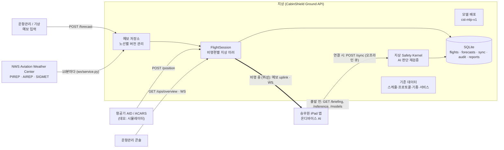
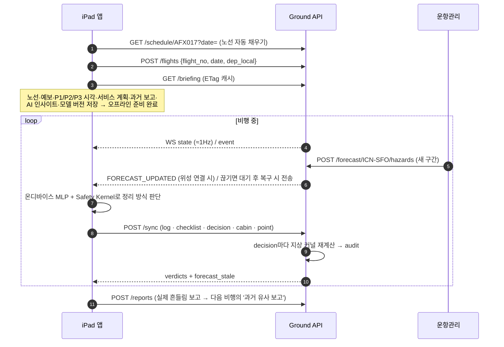
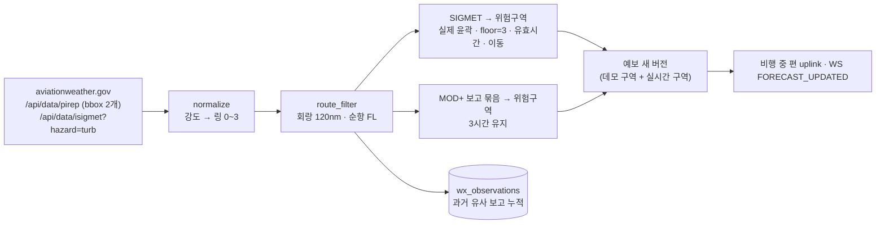
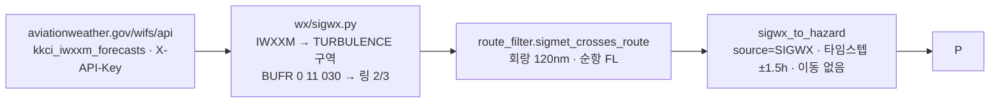

# CabinShield 지상 서버 아키텍처 (v0.2)

> 원칙: **판단은 기내 태블릿이 한다.** 서버는 판단에 필요한 데이터를 공급하고, 결과를 받아 검증·보관한다.
> 위성 연결이 끊겨도 앱은 출발 전에 받은 브리핑 패키지와 온디바이스 모델로 계속 동작한다.

## 1. 전체 구성



## 2. 비행 한 편의 흐름



## 3. 계산 규칙 (앱과 동일)

| 항목 | 정의 | 코드 |
|---|---|---|
| 노선 | ICN→SFO 대권항로, 4,906 nm | `engine/geo.py` |
| 예보 구간 | 8각 다각형, 링 3단계(100/66/33% = 약함/보통/심함), FL 범위, 동쪽으로 drift | `engine/flight.py` |
| 다음 구간 | 현재 위치·속도로 1시간 앞을 5초 간격으로 탐색 | `look_ahead()` |
| 전체 구간 | 계획 지상속도 492kt로 노선 전체를 8nm 간격 탐색 | `exposures()` |
| 포인트 | 구간 진입 23/13/5분 전 = P1/P2/P3, 구간 안 = 3포인트 착석 유지 | `engine/tta.py` |
| TTA 불확실성 | σ = hypot(예보 오차 5nm + 3nm/h·경과, 위치 오차) / 지상속도 | `tta_estimate()` |
| Q_low | TTA − 1.28σ (보수적 10% 하한) | 〃 |
| CST | MLP 38→32→16→3 (1,827 파라미터) p90 예측 + 보정 마진 | `engine/cst.py` |
| CSM | Q_low − (CST + 마진) − 10s, 5s 미만 '빠듯' | `engine/csm.py` |
| 선택 | 통과하는 가장 철저한 방식 (FULL → MINIMAL → IMMEDIATE), 없으면 즉시 착석 | `decide()` |
| 서비스 계획 | 구간 앞 10분+α·뒤 10분을 피해 이동/간소화/생략 | `planner/rule_based.py` |

앱 코드와 일치하는지는 `tests/test_engine.py`가 앱에서 추출한 기준값(`tests/fixtures/golden_ts.json`)으로 검사한다.

## 4. 데이터 모델

### 기준 데이터 (`app/data/seed/`, 읽기 전용)

| 파일 | 내용 |
|---|---|
| `schedule.json` | 편명, 출발/도착, 출발 시각(KST), 소요시간, 기종, 운항 요일, 데모 지원 여부, route_id |
| `protocol.json` | P1/P2/P3 리드타임, 이름, 할 일, 요약, 안내방송 / 착석 유지 / 구간 통과 후 문구 |
| `aircraft.json` | B787-9 승무원 위치·역할, 휴식 조, 구역 배치, 화장실 6·갤리 3 |
| `services.json` | 1차 식사 · 중간 스낵 · 2차 식사 (선호 시작, 소요, 간소화 소요, 생략 가능) |
| `places.json` | 지도 지명·공항 |
| `history_ICN-SFO.json` | 과거 유사 난기류 보고 구간 (거리 범위, 건수, FL, 원인, 강도, 계절) |
| `hazards_ICN-SFO.json` | 기본 예보 (첫 실행 시 v1로 저장) |

모든 문구는 `{"ko", "en"}` 이중 언어.

### 운영 데이터 (SQLite)

```text
flights            id(AFX017-20261112) · flight_no · date · route_id · aircraft · dep_local · dep_utc · status · feed
forecast_versions  route_id · version · issued_at · source(seed|ops|scenario) · hazards[]
sync_events        id(클라이언트 UUID, 멱등) · flight_id · device_id · kind · t_s · at · payload
decision_audit     event_id · client_pick · server_pick · agree · flags[UNSAFE_PICK|CST_DRIFT|UNKNOWN_MODEL] · detail
reports            flight_id · route_id · t_s · d_nm · lat/lon · fl · severity(1-3) · note
server_events      flight_id · kind · t_s · msg{ko,en} · data
```

### sync 이벤트 종류

| kind | payload |
|---|---|
| `log` | `{msg: {ko, en}}` 앱 알림 기록 |
| `checklist` | `{point, index, done}` |
| `decision` | `{features[38], q_low_s, pick, cst_s, csm_s, model_version}` → 지상 재검증 |
| `cabin` | `{serviceStopped, cartsSecured, hotStowed, galleySecured, lavsCleared}` |
| `point` | `{point}` 앱이 표시 중인 포인트 |
| `link` | `{aid, sat}` 앱이 본 연결 상태 |

## 5. 시간 기준

- `t_s`: 출발 후 경과 초 (앱 FlightSim과 같은 시계). UTC = `dep_utc + t_s`.
- 시뮬레이터 모드: 서버가 60배속(구간 26분 전부터 10배속)으로 비행. 데모 시작 위치는 350nm.
- 항공기 피드 모드(`feed=AIRCRAFT_FEED`): `POST /position`의 위경도를 노선에 투영해 거리·시간을 갱신.

## 6. 보안·배포

- 쓰기: `X-API-Key` (`CS_API_KEY`), 예보 입력·항공기 피드·시나리오: `CS_OPS_API_KEY`(없으면 API 키). WS는 `?token=`.
- 읽기(스케줄·기준 데이터·브리핑·모델)는 태블릿 캐시를 위해 열어 두고 ETag/304로 재다운로드를 줄인다.
- Docker 단일 워커(Render / Fly.io). 확장 시: 세션 → Redis, 저장소 → Postgres(`Store` 교체), 시뮬레이터 → 별도 워커.

## 7. 실시간 항공기상 연동 (NWS Aviation Weather Center)



| 항목 | 값 |
|---|---|
| 인증 | 없음 (공개 API). 사용자 지정 User-Agent 필수 |
| 제한 | 분당 100회, 쿼리당 400건 → 서버는 분당 30회 상한, 수집 1회에 3요청 |
| 빈 결과 | HTTP 204 |
| PIREP 범위 | 미국·북태평양 위주 (ICN-SFO 동쪽 구간 밀도 높음) |
| SIGMET 범위 | 전 세계 (Oakland/Anchorage Oceanic, Fukuoka 등 포함) |
| 강도 매핑 | NEG 0 · LGT/LGT-MOD 1 · MOD/MOD-SEV 2 · SEV/EXTM 3 |

위험구역 확장 필드 (앱과의 차이): `centre_ll`, `t_obs_utc`, `vertices_nm`(실제 윤곽), `floor`(구역 안 최소 강도), `drift_dir_deg`, `valid_from_utc`/`valid_to_utc`. 없으면 기존과 똑같이 동작하므로 데모 예보 결과는 바뀌지 않는다. **앱이 실시간 구역을 그대로 계산하려면 `src/domain/flight.ts`의 Hazard에도 같은 필드를 추가해야 한다.**

### 7.1 WAFS 고고도 SIGWX (WIFS API, 선택)



| 항목 | 값 |
|---|---|
| 인증 | WIFS 승인 계정 + `X-API-Key` (`CS_WIFS_API_KEY`), 키 유효 1년 |
| 제한 | API 엔드포인트 스레드당 분당 1회, 하루 5,000회 → 서버는 60초 간격, 30분 캐시 |
| 갱신 | 하루 4회 (≈05:50/11:50/17:50/23:50 UTC), 앞으로 12시간 타임스텝 수집 |
| 실패 | 마지막 SIGWX 구역 유지, `sigwx_error` 기록. SIGMET/PIREP은 계속 갱신 |

`LIVE_SOURCES = ("SIGMET", "PIREP", "SIGWX")` — replay 모드 시간 이동과 `/wx/{route}/areas`에 같이 적용된다.

## 8. 앱 연동 순서 (제안)

1. 비행편 시작 화면: `GET /schedule/{no}?date=` 로 노선 카드 채우기 → `POST /flights`
2. 시작 직후 `GET /briefing` 저장 (예보·포인트 시각·서비스 계획·과거 보고·인사이트)
3. `GET /models/cst` 의 `sha256`가 번들과 다르면 `/models/cst/{version}` 다운로드
4. 비행 중 WS 구독, `FORECAST_UPDATED` 수신 시 `/forecast/{route}?since=` 갱신
5. 알림 기록·체크·AI 판단을 로컬 큐에 쌓고 연결될 때 `POST /sync`
